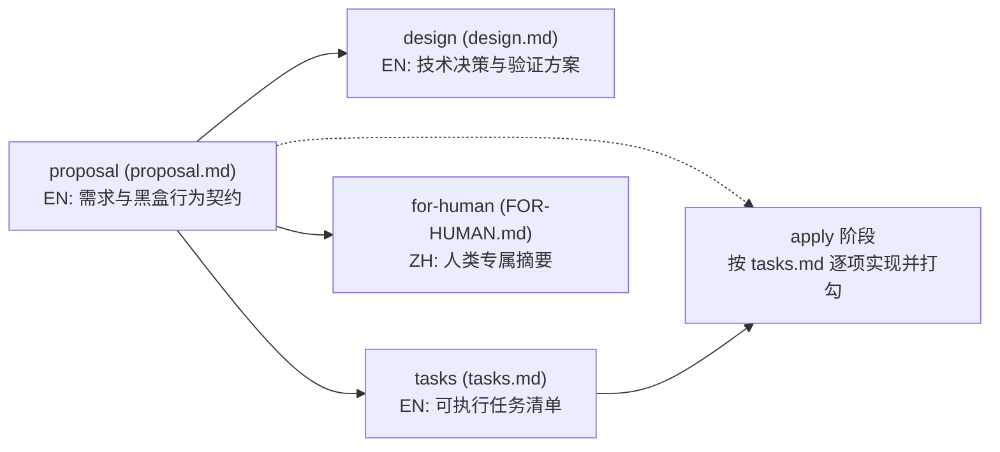

# opsx-schema-driven (`proposal-driven` OpenSpec Schema)

以 **`proposal.md` 为唯一需求真相源**、禁用 `specs/` 增量语法、内置 `tasks.md` 进度追踪与 `FOR-HUMAN.md` 人类中文摘要的 [OpenSpec](https://github.com/Fission-AI/OpenSpec) 工作流 Schema（实测支持 OpenSpec `1.14.0`）。

---

## 快速安装与使用

### 1. 一键交互式初始化项目（推荐，免克隆）

在任意项目根目录运行，自动从本机 `openspec init --help` 拉取支持的 Agent 列表，通过**方向键 + 空格多选**一次性完成：**Agent 配置 (`openspec init`) + Schema 安装 + `openspec/config.yaml` 绑定**。

**PowerShell：**
```powershell
irm https://raw.githubusercontent.com/marble810/opsx-schema-driven/main/scripts/install.ps1 | iex
```

**Bash (Linux / macOS / Git Bash)：**
```bash
bash <(curl -fsSL https://raw.githubusercontent.com/marble810/opsx-schema-driven/main/scripts/install.sh)
```

---

### 2. 克隆仓库并安装（适合本机全局复用或脚本化调用）

```powershell
git clone https://github.com/marble810/opsx-schema-driven.git
cd opsx-schema-driven

# 方式 A：复制到本机全局目录 (%LOCALAPPDATA%\openspec\schemas\proposal-driven)
.\scripts\install.ps1 -Global

# 方式 B：用 Junction 软链到本机全局（改本仓库模板全机实时生效，无需管理员权限）
.\scripts\install.ps1 -Link

# 方式 C：仅把 Schema 复制到指定业务项目（随项目 Git 提交）
.\scripts\install.ps1 -TargetProject "F:\Git\YourProject"
```

```bash
# Bash 对应命令
./scripts/install.sh --global
./scripts/install.sh --link
./scripts/install.sh --target-project /path/to/your-project
```

> 全局安装后，在任意项目的 `openspec/config.yaml` 中写一行 `schema: proposal-driven` 即可启用。

| 安装方式 | 项目仓库干净度 | 团队/多机协作 | 更新维护 |
| :--- | :--- | :--- | :--- |
| **全局复制 (`-Global`)** | 极高（仅一行 `config.yaml`） | 每台机器装一次 | 重跑脚本覆盖 |
| **全局软链 (`-Link`)** | 极高（项目内零模板） | 每台机器克隆并挂软链 | `git pull` 即刻全机生效 |
| **项目内嵌 (`-TargetProject`)** | 含 `openspec/schemas/` | **随项目 Git 开箱即用** | 按项目独立锁版本 |

---

## 核心设计与产物结构

- **禁用 `specs/`**：消除 `proposal` ↔ `specs` ↔ `design` 跨文件三重复读；`proposal.md` 通过正交的 `What Changes`（结构改动）+ `Behavior`（黑盒可观测行为契约）直接作为唯一真相源。
- **人机双语分离**：
  - `proposal.md` / `design.md` / `tasks.md` 使用**高密度技术英文**（与代码库标识符零跨语种损耗，省 40%+ Token）；
  - `FOR-HUMAN.md` 使用**简明简体中文**（专供人类 60 秒审阅，并在指令层禁止 LLM 回读）。



| 产物 ID | 文件 | 语言 | 依赖 | 说明 |
| :--- | :--- | :--- | :--- | :--- |
| `proposal` | `proposal.md` | EN | `[]` | 包含 `Why`、`What Changes`、`Behavior`、`Impact`（`## Why` 与 `## What Changes` 为 `openspec validate` 硬性要求标题） |
| `design` | `design.md` | EN | `["proposal"]` | 技术选型、验证与回滚方案。**小改动支持一行短路**（见下） |
| `tasks` | `tasks.md` | EN | `["proposal"]` | `- [ ] X.Y` 任务复选框，由 `apply` 自动追踪完成度 |
| `for-human` | `FOR-HUMAN.md` | 中文 | `["proposal"]` | 背景与目的 / 核心改动与保证 / 怎么验证 / 出问题怎么办 |

---

## 关键机制与已知局限 (Known Limitations)

1. **`design.md` 的可选短路规则**：OpenSpec 状态机目前不支持 `optional: true` 产物，缺 `design.md` 会导致状态显示未完成。因此当改动极小、无架构分歧时，Agent 会在 `Context` 与 `Decisions` 下写一行 `"Same as proposal.md; single straightforward implementation path with no architectural ambiguity."` 并删去可选节，兼顾状态机闭环与零 Token 浪费。
2. **`FOR-HUMAN.md` 的隔离上限**：`schema.yaml` 在 `tasks` 与 `apply` 阶段严禁 LLM 读取或引用 `FOR-HUMAN.md`，但这属于**提示词契约级隔离**而非物理权限隔离（若用户手动要求 Agent 扫描全目录 `.md`，仍可能进入上下文）。
3. **`for-human` 计入 Planning 完成度**：当前需 `4/4` 产物全部生成才算 `isPlanningComplete`。
4. **语言策略**：前三个机器契约采用英文，`FOR-HUMAN.md` 默认固定输出简体中文。

---

## 验证与卸载

```powershell
# 运行端到端自动化验收（在临时隔离目录测试 validate / smoke change / apply 追踪 / 全局安装）
.\scripts\verify.ps1

# 卸载用户级全局 Schema（仅删全局目录或软链，不删源码仓库）
.\scripts\uninstall.ps1
```

```bash
./scripts/verify.sh
./scripts/uninstall.sh
```

> 注：`openspec validate` 输出 `skip_specs is set in .openspec.yaml` 的 `INFO` 属于禁用 `specs/` 后的预期正常现象。

## License

[MIT](./LICENSE)
