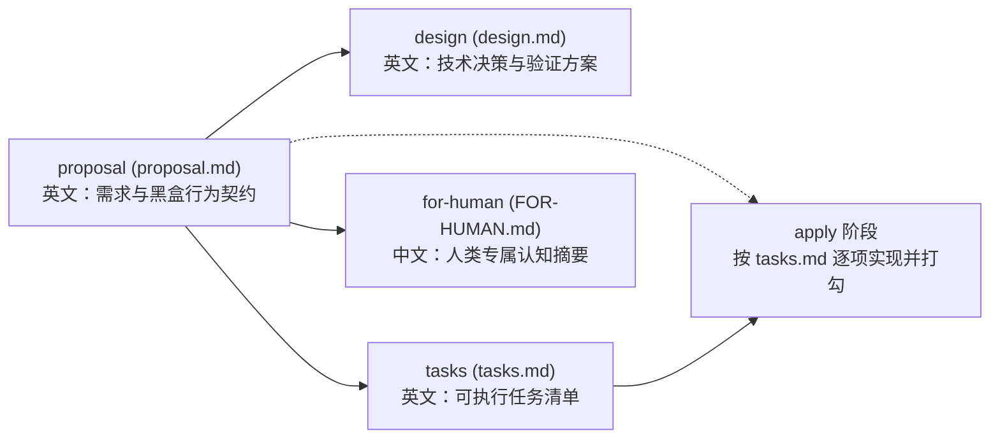

# opsx-schema-driven (`proposal-driven` OpenSpec Schema)

一套以 **`proposal.md` 为唯一需求真相源（Source of Truth）**、禁用繁琐 `specs/` 增量语法、内置 `tasks.md` 进度追踪与 `FOR-HUMAN.md` 人类认知摘要的 [OpenSpec](https://github.com/Fission-AI/OpenSpec) 工作流 Schema。

> **实测环境**：OpenSpec CLI `1.14.0`（Windows PowerShell / Linux / macOS）  
> **人机双语分离策略**：面向 LLM 执行的三个规划产物（`proposal.md` / `design.md` / `tasks.md`）采用**高密度技术英文**，面向人类审阅的 `FOR-HUMAN.md` 采用**简明简体中文**。

---

## 为什么需要这套 Schema？

OpenSpec 默认的 `spec-driven` 工作流要求维护 `openspec/specs/` 目录与严格的 `ADDED/MODIFIED/REMOVED Requirements` + `#### Scenario:` 语法块。在中小型工程、快速迭代或单人/小团队 AI 辅助开发中，这套机制往往带来两个痛点：

1. **信息割裂与复读成本高**：同一个改动要在 `proposal.md`、`specs/`、`design.md` 里反复描述三遍，浪费上下文窗口（Token）且极易产生文档漂移。
2. **人机阅读诉求冲突**：LLM 最擅长处理与代码库同语种（英文）、高密度的结构化契约；而人类审阅者希望用 60 秒看懂中文白话总结。如果把两者混在同一个文件里，既浪费 LLM 的上下文 Token，又降低人类阅读效率。

**`proposal-driven` 的核心设计：**
- **完全禁用 `specs/`**：由 `proposal.md` 承担完整的需求契约（通过正交划分的 `What Changes` 结构清单 + `Behavior` 黑盒行为契约替代传统 spec）。
- **人机双语与读写分离**：
  - `proposal.md`、`design.md`、`tasks.md`（**LLM-to-LLM 契约，英文**）：与代码符号零跨语种对齐损耗，Token 密度高；
  - `FOR-HUMAN.md`（**LLM-to-Human 摘要，简体中文**）：单向把前面的英文技术方案浓缩翻译成大白话中文，且在指令层禁止 LLM 在后续步骤回读该文件。
- **元提示词（Meta-Prompting）工程化架构**：每个产物均按「角色与认识论边界 → 硬性解析器不变量 → 前置代码调研协议 → 正交章节契约 → 自检门禁（Self-check Gate）」五层结构编写。

---

## 产物依赖图与工作流结构



| 产物 ID | 生成文件 | 语言 | 依赖 (`requires`) | 核心职责 |
| :--- | :--- | :--- | :--- | :--- |
| `proposal` | `proposal.md` | English | `[]` | **唯一需求真相源**：包含 `Why`、`What Changes`（结构改动）、`Behavior`（黑盒可观测行为）、`Impact`、`Non-Goals`、`Open Questions`。其中 `## Why` 与 `## What Changes` 为 `openspec validate` 硬性要求的二级标题。 |
| `design` | `design.md` | English | `["proposal"]` | **技术决策记录**：回答“怎么做”与“为什么选 X 而不选 Y”，包含验证方案与回滚路径。支持小改动一行短路。 |
| `tasks` | `tasks.md` | English | `["proposal"]` | **拓扑执行清单**：按依赖顺序拆解为 `- [ ] X.Y` 复选框任务，由 `apply` 阶段自动追踪完成度。 |
| `for-human` | `FOR-HUMAN.md` | 简体中文 | `["proposal"]` | **人类认知摘要**：用直白简短的中文回答“背景与目的 / 核心改动与保证 / 怎么验证 / 出问题怎么办”。 |

### 关于 `design` 的“可选但需短路”机制

OpenSpec `1.14.0` 的状态机对声明在 `schema.yaml` 中的所有 artifact 一视同仁——没有 `optional: true` 标记。只要不生成 `design.md`，`openspec status` 就会显示未完成（`ready`），`/opsx:ff` 等指令也会推着 Agent 去生成它。

因此本 Schema 在 `design` 的指令与模板中内置了**短路规则（Short-Circuit Rule）**：
- 当改动涉及多模块、外部依赖、数据迁移或架构权衡时，正常编写完整设计；
- 当改动极小、`proposal.md` 已无任何实现歧义时，Agent 仍会创建 `design.md`，但在 `## Context` 与 `## Decisions` 下仅写一行 `Same as proposal.md; single straightforward implementation path with no architectural ambiguity.` 并删去所有可选章节，既让状态机干净闭环，又零 Token 浪费。

### 关于 `FOR-HUMAN.md` 的隔离约定与语义上限

`FOR-HUMAN.md` 旨在做**人机上下文隔离**：
- 生成时，它是 LLM 根据 `proposal.md` 与 `design.md` 翻译给人类看的单向输出（Write-only Sink）；
- 在 `tasks` 与 `apply` 阶段，`schema.yaml` 明确规定：`NEVER open, read, quote, or copy FOR-HUMAN.md as LLM context`。
- **已知语义上限**：这属于**提示词契约级隔离（Prompt-level Isolation）**而非操作系统物理隔离。如果某个 Agent 工具被用户手动要求“读取目录下所有 `.md` 文件”，token 依然会进入上下文；但在标准 OpenSpec 工作流指令下，Agent 会严格跳过它。

---

## 安装与使用指南

本仓库提供一体化的安装与项目初始化脚本 `scripts/install.ps1`（Windows PowerShell）与 `scripts/install.sh`（Linux / macOS / Git Bash）。

### 方式一：超级一键初始化新项目（推荐）

在任意业务项目下运行脚本，启动**交互式向导（TUI）**，一次性完成：
1. 动态调用本机 `openspec init --help` 获取当前版本支持的所有 AI Agent 列表（常用项如 `antigravity`、`pi`、`claude`、`codex`、`cursor` 自动置顶）；
2. 方向键 + 空格多选需要启用的 Agent，执行 `openspec init`；
3. 将 `proposal-driven` Schema 安装到项目目录（或本机全局目录），并自动把项目 `openspec/config.yaml` 的默认 Schema 设为 `proposal-driven`。

**PowerShell（远端一行命令，在当前项目下直接弹出交互向导）：**
```powershell
irm https://raw.githubusercontent.com/marble810/opsx-schema-driven/main/scripts/install.ps1 | iex
```

**PowerShell（本地克隆后运行）：**
```powershell
git clone https://github.com/marble810/opsx-schema-driven.git
.\opsx-schema-driven\scripts\install.ps1
```

**Bash（Linux / macOS / Git Bash 远端一行命令）：**
```bash
bash <(curl -fsSL https://raw.githubusercontent.com/marble810/opsx-schema-driven/main/scripts/install.sh)
```

---

### 方式二：安装到本机用户级全局目录（一处安装，全机可用）

将 Schema 安装到 OpenSpec 的用户级数据目录：
- **Windows**: `%LOCALAPPDATA%\openspec\schemas\proposal-driven`
- **Linux / macOS**: `${XDG_DATA_HOME:-~/.local/share}/openspec/schemas/proposal-driven`

```powershell
# PowerShell：复制安装到本机全局（即使后续删掉本仓库也不受影响）
.\scripts\install.ps1 -Global

# PowerShell：或者用 Junction 软链接到本仓库（适合经常微调模板、希望全机实时生效）
.\scripts\install.ps1 -Link
```

```bash
# Bash：复制安装到本机全局
./scripts/install.sh --global

# Bash：或者用 Symlink 软链接到本仓库
./scripts/install.sh --link
```

全局安装完成后，在任意业务项目的 `openspec/config.yaml` 中写上一行即可启用：
```yaml
schema: proposal-driven
```

---

### 方式三：仅复制 Schema 到指定项目（不重跑 `openspec init`）

如果你希望 Schema 随业务项目自身的 Git 仓库一起提交（不依赖协作者本机全局环境）：

```powershell
.\scripts\install.ps1 -TargetProject "F:\Git\YourProject"
```
```bash
./scripts/install.sh --target-project /path/to/your-project
```

### 三种安装方式的取舍对比

| 维度 | 用户级全局复制 (`install` 默认) | 用户级全局软链 (`-Link` / `--link`) | 项目级内嵌 (`-TargetProject` / `-InitProject`) |
| :--- | :--- | :--- | :--- |
| **项目仓库干净度** | 极高（项目内仅需 `config.yaml` 一行配置） | 极高（项目内零模板文件） | 项目内含 `openspec/schemas/proposal-driven/` |
| **多机/团队协作** | 需每台机器执行一次全局安装 | 需每台机器克隆本仓库并挂软链 | **开箱即用**（随业务项目 Git 同步） |
| **更新维护体验** | 重跑一次 `install` 脚本即可覆盖更新 | 本仓库 `git pull` 或改文件即刻全机生效 | 按项目独立演进、锁死版本，互不影响 |

---

## 验证与卸载

### 运行端到端自检

本仓库内置自动化验收脚本，会在临时隔离目录中完整测试 Schema 语法校验、冷启动 `new change`、`validate`、`status`、`apply` 进度追踪及用户级目录解析：

```powershell
.\scripts\verify.ps1
```
```bash
./scripts/verify.sh
```

> **提示**：执行 `openspec validate` 时，CLI 输出 `skip_specs is set in .openspec.yaml` 的 `INFO` 日志属于**预期正常行为**（因为本 Schema 显式禁用了 `specs/`）。

### 卸载用户级全局 Schema

只清理用户级全局目录中的副本或软链接，**绝不会删除**本源码仓库：

```powershell
.\scripts\uninstall.ps1
```
```bash
./scripts/uninstall.sh
```

---

## 已知局限与演进方向 (Known Limitations)

1. **`design` 的“可选”与状态机冲突**：OpenSpec 目前不支持 `optional: true` 的 artifact。当前通过“单行短路说明”缓解；未来若需彻底消除，可拆分为 `proposal-driven`（无 design）与 `proposal-design` 两个变体，或待上游支持可选产物。
2. **`for-human` 参与 Planning 完成度计数**：当前必须 `4/4` 产物全部生成才算 `isPlanningComplete`。若实际使用中希望先写代码最后再生成人类摘要，后续可评估将其移出前置规划链。
3. **“LLM 禁读”的语义上限**：如前文所述，`FOR-HUMAN.md` 的隔离依赖指令层强约束而非文件系统权限隔离。
4. **`FOR-HUMAN.md` 绑定简体中文**：前三个机器契约已采用通用英文，但 `FOR-HUMAN.md` 仍默认要求输出简体中文（自用优先）；未来若需纯英文版本可衍生独立模板。
5. **CLI 解析器硬契约依赖**：`proposal.md` 中的 `## Why` 与 `## What Changes` 是 `openspec validate` 源码写死的正则锚点，任何二次定制均不可修改这两个二级标题。

---

## License

[MIT](./LICENSE)
